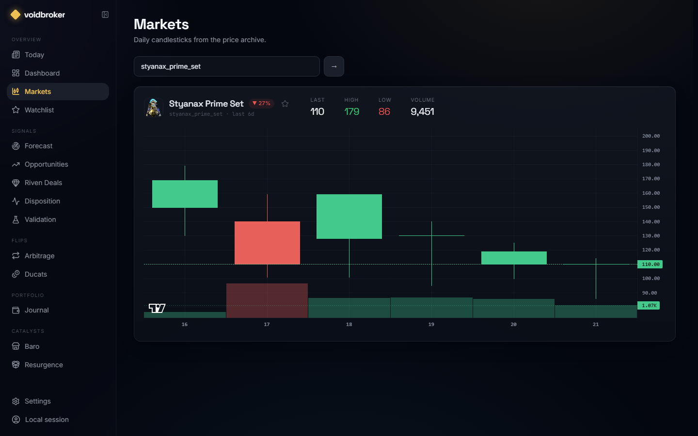
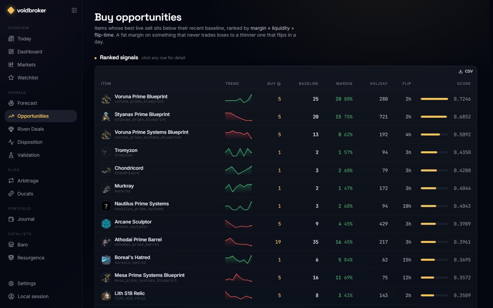
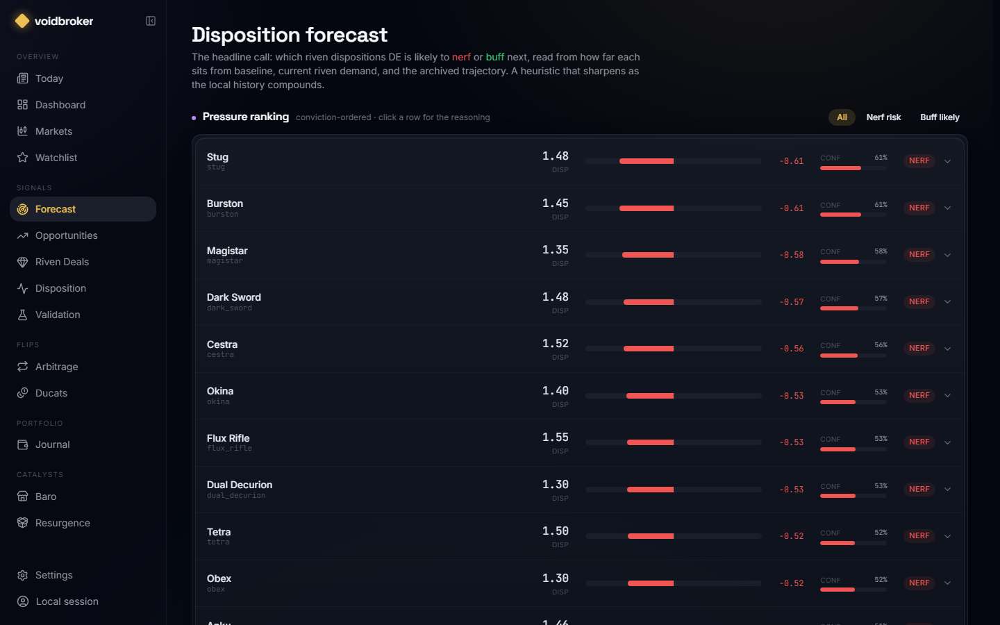
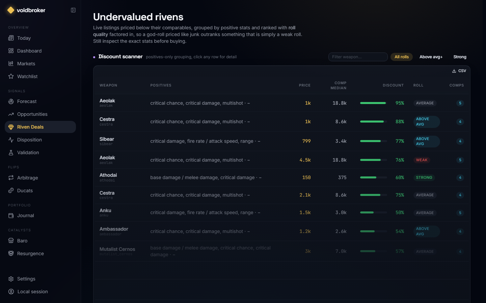

# voidbroker

[](https://github.com/Ferinjoque/voidbroker/actions/workflows/ci.yml)

A **local-first quant terminal for the Warframe Market economy.** Not another
"buy low / sell high" price checker. voidbroker is built around the parts of the
Warframe economy that are structurally inefficient and hard for humans to reason about,
and it archives the data those edges require.

> Status: **backend complete + terminal UI + predictive signals, validated.** Ingestion
> (tiered, resumable, unattended), a local archive, and the full signal stack: liquidity-
> adjusted opportunities, roll-quality-ranked riven deals, a disposition forecast, Prime
> Resurgence price-impact, and Baro. Everything is rolled into a one-screen **digest**, and
> the signals are **backtested** against the archive (buy-the-dip and the disposition
> predictor). A Warframe-themed React terminal with item thumbnails surfaces it all. See
> [docs/ROADMAP.md](docs/ROADMAP.md) for what's next.
>
> **Honest status:** the buy-the-dip edge is backtested on the live archive (+16.7% median
> edge). The disposition predictor is a transparent heuristic (v1); its accuracy is only
> *proven* once the archive captures a real DE rebalance, so treat that call as directional,
> not validated, until then. The product's moat is the dataset compounding over time.

## Screenshots

| Markets | Opportunities |
|---|---|
|  |  |
| **Disposition forecast** | **Undervalued rivens** |
|  |  |

## Why it exists

warframe.market only exposes ~90 days of history and no archive of disposition over
time. voidbroker snapshots the market on a schedule and **stores it forever** in a local
DuckDB file. The longer it runs, the more proprietary the dataset becomes: that's the moat.

### The edges it's built to chase

1. **Riven disposition prediction** *(shipped, v1)*: disposition (the riven strength
   multiplier DE sets per weapon from usage) is captured on every ingest, and a predictor
   reads distance-from-baseline, current riven demand, and the archived trajectory to call
   the *next* nerf/buff before DE ships it. Heuristic today; gets data-driven as history
   compounds.
2. **Riven fair-value model + undervalued-listing scanner**: appraise unique randomized
   rivens and flag god-rolls priced like junk.
3. **Event-driven forecasting**: Prime vault lifecycle, Baro rotations, balance patches
   as catalysts.
4. **Liquidity-adjusted scoring**: every opportunity weighted by *how fast it flips*,
   not just margin. Headline prices use only live (online/in-game) orders.

## Stack

| Layer | Choice | Why |
|-------|--------|-----|
| Language | **Python 3.11+** | The project is fundamentally data + ML |
| Store | **DuckDB** (single file) | Embedded columnar OLAP, built for time-series analytics, zero server |
| HTTP | **httpx** (async, rate-limited) | Polite ~3 req/s sweeps of the API |
| API | **FastAPI** | The read API the terminal talks to |
| Scheduler | **APScheduler** | Recurring snapshots that build the archive |
| Tooling | **uv** + **pytest** | Fast, reproducible, fully local |

Everything runs locally. No hosting required: clone, `uv sync`, and replicate.

## Quickstart

```bash
uv sync                       # install into a local .venv
cp .env.example .env          # optional: defaults work out of the box

# Build the archive (catalog + 90d price history). --limit keeps a first run quick.
uv run voidbroker ingest --limit 50

uv run voidbroker info        # show what's in the archive
uv run voidbroker doctor      # per-source ingestion coverage + freshness
uv run voidbroker serve       # read API at http://127.0.0.1:8000  (docs at /docs)
```

Flags for `ingest`: `--orders` (live order books), `--rivens` (riven auctions per weapon),
`--worldstate` (Baro / catalysts), `--details` (per-item ducats + set composition, for the
arbitrage/ducat signals). Each is one-call-per-item heavier; combine as needed.
`--batch N` processes only the **stalest N refs per source**: bounded, resumable sweeps
that rotate through the whole catalog (use this for scheduled runs).

### Run it on a cadence (the moat)

The archive only compounds if ingestion runs regularly. For unattended operation, register
a repeating bounded ingest with your OS scheduler; it survives reboots and stays polite:

```powershell
# Windows: bounded ingest every 6h (see docs/OPERATIONS.md for cron / systemd).
powershell -ExecutionPolicy Bypass -File scripts/install-schedule.ps1 -IntervalHours 6 -Batch 400
```

Or keep a foreground process (same tiered batching):

```bash
uv run voidbroker schedule --interval-hours 6 --batch 400 --auction-batch 40   # Ctrl+C to stop
```

`voidbroker doctor` (or `GET /health/ingest`) shows coverage % and the oldest/newest fetch
per source so you can confirm sweeps are keeping up. Full guide: [docs/OPERATIONS.md](docs/OPERATIONS.md).

### Signals at a glance (CLI)

```bash
uv run voidbroker digest                  # one briefing: the few things worth acting on now
uv run voidbroker signals                 # liquidity-adjusted buy opportunities
uv run voidbroker forecast                # predicted next disposition buffs/nerfs
uv run voidbroker backtest                # disposition-predictor accuracy vs realized changes
uv run voidbroker backtest-opportunities  # did buying the dip historically pay?
uv run voidbroker deals --positives-only  # undervalued riven listings (roll-quality ranked)
uv run voidbroker arbitrage               # set-vs-parts flips (build a set, or split one)
uv run voidbroker ducats                  # cheapest plat→ducat conversions for Baro
uv run voidbroker journal                 # trade-journal P&L (log trades in the web UI)
uv run voidbroker alert                   # surface NEW high-conviction signals + notify
uv run voidbroker baro                    # void trader status + inventory
uv run voidbroker resurgence              # Prime Resurgence: what's unvaulted + when it closes
```

### Frontend terminal

A Warframe-themed React terminal lives in [`web/`](web/) (Vite + Tailwind +
lightweight-charts). With `voidbroker serve` running:

```bash
cd web && npm install && npm run dev      # http://localhost:5173
```

Every signal has a screen (digest, markets, opportunities, riven deals, forecast,
arbitrage, ducats, journal, Baro, resurgence, validation) plus a local **watchlist** you
pin items to. A `⌘/Ctrl-K` command palette jumps to any view or searches the whole
catalog; analytical tables export to **CSV**; the active view + item live in the URL, so a
refresh or a shared link lands you back where you were. Responsive down to mobile, with
reduced-motion and compact-density toggles.

### Read API

| Endpoint | Returns |
|----------|---------|
| `GET /digest` | Cross-signal "act on this now" briefing |
| `GET /summary` | Row counts across the archive |
| `GET /health/ingest` | Per-source ingestion coverage + freshness |
| `GET /items/{slug}/prices` | Daily candlestick series |
| `GET /items/{slug}/orderbook` | Latest live order-book aggregate |
| `GET /weapons/{slug}/disposition` | Disposition history (the predictor's data) |
| `GET /leaderboard/volume` | Most-traded items by latest-day volume |
| `GET /signals/opportunities` | Liquidity-adjusted buy opportunities, ranked |
| `GET /signals/disposition-forecast` | Predicted next disposition buffs/nerfs, ranked by conviction |
| `GET /signals/disposition-backtest` | Walk-forward accuracy of the predictor vs realized changes |
| `GET /signals/opportunity-backtest` | Did buying below baseline historically pay (median return, edge)? |
| `GET /signals/disposition-changes` | Detected riven disposition buffs/nerfs over time |
| `GET /signals/riven-deals` | Undervalued riven listings vs comparables |
| `GET /signals/set-arbitrage` | Prime set vs summed-parts price gaps (build/split flips) |
| `GET /signals/ducats` | Items ranked by ducats-per-platinum (Baro prep) |
| `GET /rivens/{weapon}/auctions` | Latest stored riven auctions for a weapon |
| `GET /catalysts/void-trader` | Baro Ki'Teer status + inventory |
| `GET /catalysts/resurgence` | Prime Resurgence (Varzia): unvaulted Primes + re-vault countdown |
| `GET /journal` | Trade-journal P&L (realized + unrealized) and open positions |
| `POST /trades` · `DELETE /trades/{id}` | Log / remove a trade (the only mutating endpoints) |

### How opportunities are scored

Opportunities are items whose best **live** sell price sits below their recent baseline,
scored by `margin% × liquidity ÷ (1 + est. flip-days)`, so a fat margin on something
that never trades ranks *below* a thinner margin that flips in a day. Requires an
`ingest --orders` pass first (live order books). Weights are documented heuristics (v1),
to be recalibrated against realized flips as history accumulates.

## Tests

```bash
uv run pytest
```

Network is fully mocked (respx) and the DB runs in-memory, so the suite is fast and offline.

## Data sources

- warframe.market **v2** API: catalog (`/items`), riven weapons + disposition
  (`/riven/weapons`), live orders (`/orders/item/{slug}`)
- warframe.market **v1** API: price statistics (`/items/{slug}/statistics`)

See [`docs/`](docs/) for the API reference and reconciliation notes.

## License

[MIT](LICENSE). Not affiliated with Digital Extremes or warframe.market.
